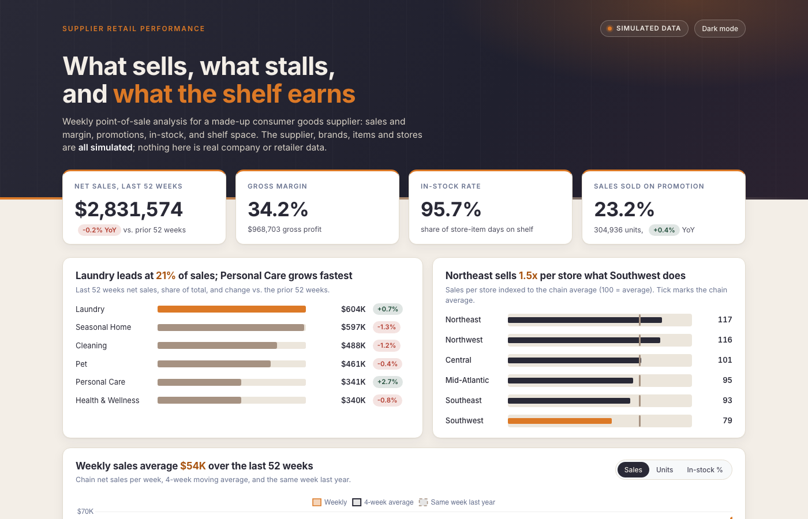

# Supplier Retail Performance

A retail analytics project: weekly point-of-sale data for a made-up consumer goods supplier, analyzed in SQL (CTEs, window functions) and shown in an interactive dashboard. It covers category and item performance, promotion lift, out-of-stocks, shelf space, and regional differences.



> **All data in this project is simulated.** The supplier, brands, items, stores and every number are generated by `etl/generate_data.py` with a fixed random seed. Nothing comes from a real retailer, a real company, or a data provider. Findings below describe this simulated dataset and reflect the assumptions built into the generator (for example how much promotions lift sales); they are not real-world conclusions.

## Why I built it

Sales and category analyst roles ask for the same toolkit: pull weekly sales data, compare years, rank items, judge promotions, and find where product is out of stock or sitting on too much shelf. I wanted one project that practices all of it end to end, with data shaped the way a supplier receives it from a big-box retailer.

## The dataset (simulated)

| | |
|---|---|
| Items | 30, in 6 categories, from 4 invented brands |
| Stores | 40, in 6 regions and 3 formats |
| Time | 156 weeks, 2023-11-05 to 2026-10-25 |
| Weekly rows | 187,200 (item x store x week) |
| Promotions | 411 events (TPR, Feature, Display) |
| Planogram | facings and linear feet per item per store cluster |

"Last 52 weeks" (LTM) means weeks 105 to 156; "prior 52 weeks" is weeks 53 to 104. Week 1 to 52 is not used in year-over-year comparisons.

## Questions it answers, and what the simulated data shows

All numbers below come from `dashboard/data.json`, produced by `etl/run_analysis.py`.

1. **How is the business doing?** Last 52 weeks: $2,831,574 net sales, down 0.2% vs. the prior 52 weeks; units up 0.4%. Gross margin 34.2%.
2. **Which categories lead?** Laundry (21% of sales, $604K) and Seasonal Home (21%, $597K). Personal Care grows fastest at +2.7%; Cleaning is down 1.2%.
3. **Do promotions pay?** In this simulation, Display promotions (+69% average lift) netted +$15,786 after discounts, Feature (+99% lift) lost $9,712, and TPR (+41% lift) lost $38,136. Net incremental profit subtracts the profit the baseline units would have earned at regular price, so a promotion has to out-sell its discount to pay.
4. **What do out-of-stocks cost?** In-stock rate is 95.7%. Estimated lost sales over the last 52 weeks are about $143,600, led by Bright Dryer Sheets.
5. **Is shelf space allocated well?** 10 of 30 items earn under 75% of their category's sales per linear foot (flagged "Review space"); 7 earn 125% or more ("Add space"); 13 are balanced.
6. **Which regions over- or under-index?** Northeast sells 117 (chain average = 100) per store, Southwest 79.

## How it is calculated

- **Promo lift:** promo-week units divided by the item's baseline, where the baseline is the average of its non-promo weeks within 4 weeks either side, minus 1. This is a simple method; it does not adjust for seasonality beyond that short window.
- **Net incremental profit:** promo-week gross profit minus baseline units times regular-price unit profit.
- **Lost sales (estimate):** days out of stock times the item's units per in-stock day in the same region and week, valued at the item's regular price.
- **Space index:** item sales per linear foot divided by its category's sales per linear foot.

## Run it

Python 3 only, no packages.

```bash
cd etl
python3 generate_data.py     # writes ../data/*.csv (seeded: identical every run)
python3 run_analysis.py      # loads SQLite, runs sql/02_analysis_queries.sql, writes dashboard/data.json and excel/pivot_*.csv
cd ../dashboard
python3 build.py             # embeds data.json into template.html -> index.html
cd ..
python3 tests/test_pipeline.py
```

Open `dashboard/index.html` in a browser (it loads Chart.js and the Inter font from CDNs, so it needs internet).

`data/fact_pos_weekly.csv` (6.5 MB) and the SQLite file are not committed; regenerate them with the first two commands.

## What is in the repo

```
etl/generate_data.py          simulated data generator
etl/run_analysis.py           SQLite load, queries, JSON and CSV export
sql/01_schema.sql             star schema
sql/02_analysis_queries.sql   analysis: CTEs, window functions (SUM OVER, RANK, LAG, moving averages), promo baselines
data/                         star-schema CSVs (dim_*, planogram, fact_pos_monthly); Power BI ready
dashboard/                    template.html, build.py, index.html, data.json
excel/                        pivot_*.csv and EXCEL_GUIDE.md (pivot and formula steps)
powerbi/measures.dax          DAX measures
tests/test_pipeline.py        reconciliation checks
docs/                         screenshots
```

## Honest limits

- The data is simulated, so there is no real-world finding here. The promotion results in particular follow from the lift and discount ranges set in the generator.
- **Excel:** pivot-ready CSVs and a step-by-step guide are included. A finished `.xlsx` workbook is not.
- **Power BI:** the star schema CSVs and `powerbi/measures.dax` are provided to load. The DAX has **not been run in Power BI** and there is no `.pbix`; the author builds and validates those in Power BI himself.
- **Power Query:** not built or tested.
- No real retail data provider, retailer system or company data is used or implied.

## License

MIT. See [LICENSE](LICENSE).
